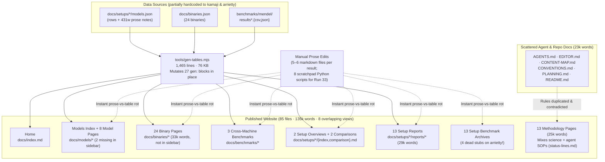
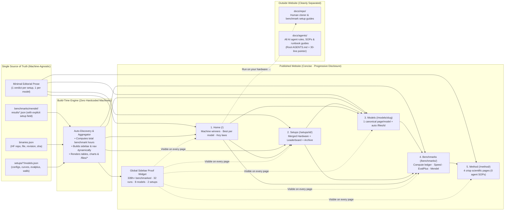

# Step 2 — Information Architecture: As-Is vs. Proposed v2

Visual maps of how the repository and website are structured today, and how v2 reorganizes them to be concise, data-driven, proof-forward, cleanly separated from `docs/agents/` and repo docs, and 100% cloneable for any hardware.

---

## 1. Current Architecture (As-Is)

### 1A. Current Website & Repo Map (ASCII)

```text
choose-a-local-llm/  (135,415 words published + 22,949 words root/repo docs)
│
├── ROOT DOCS (fragmented agent + human governance — 7+ overlapping files)
│   ├── README.md                  (616w  — hardcodes kamaji/irae)
│   ├── AGENTS.md                  (4,999w — 535 lines, standing rules + tool index)
│   ├── EDITOR.md                  (6,650w — 754 lines, page templates & rules)
│   ├── CONTENT-MAP.md             (3,856w — 27 gen: marker wiring map)
│   ├── CONVENTIONS.md             (968w  — writing & script index)
│   ├── HANDOFF.md                 (gitignored coordinator state)
│   └── benchmarks/PLANNING.md     (3,720w — coordinator/runner split)
│
├── DATA & PIPELINE (hardcodes kamaji/arrietty in 3 places)
│   ├── docs/setups/{kamaji,arrietty}/models.json   (47 rows, 43 have 30–431w prose essays in `note`)
│   ├── docs/binaries.json                          (24 entries)
│   ├── benchmarks/mendel/results{,-guided}.{csv,json,html}
│   └── tools/gen-tables.mjs                        (1,465 lines, 76 KB — mutates 27 <!-- gen: --> blocks in place)
│
└── PUBLISHED WEBSITE: docs/  (85 markdown files — 8 overlapping page types!)
    ├── index.md                                    (Home: 8-row table, orphan footnotes, 0 proof of 339h compute)
    │
    ├── models/  (9 files · 16,182w)
    │   ├── index.md                                (All configs across machines + stale prose)
    │   └── <slug>.md × 8                           (2 missing from sidebar: arete-27b, s5-nano)
    │
    ├── binaries/  (24 files · 32,995w — 24.4% of site, NOT in sidebar!)
    │   └── <binary-id>.md × 24                     (Repeats rows, EvalPlus, Mendel, presets, copy-pasted prose)
    │
    ├── benchmarks/  (3 files · 8,111w)
    │   ├── decode-speed.md                         (Generated top + huge stale hand-written matrix)
    │   ├── evalplus.md                             (Fast-mode table + contradicting old-era prose)
    │   └── mendel.md                               (Dense 8-column pill wall)
    │
    ├── methodology.md + methodology/  (13 files · 24,667w — 18.2% of site!)
    │   ├── [Scientific method]  evalplus, mendel, context-creep, quantization, reasoning-budget, kv-cache-pick, memory-ceiling
    │   └── [INTERNAL AGENT OPS LEAKED ONTO SITE]
    │       ├── status-lines.md  (4,429w! Chat heartbeat protocol, raw user typo quote, session hash, 5 model names)
    │       ├── checklist.md     (2,667w — runner ops + "GPU does not sit idle")
    │       ├── server-lore.md   (1,369w — runtime debugging notes)
    │       ├── common-rules.md  (1,082w — mixes scientific rules + record-everywhere + kamaji/arrietty)
    │       └── wired-limit.md   (951w   — macOS sysctl setup procedure)
    │
    └── setups/{kamaji,arrietty}/  (34 files · 51,436w — 38% of site!)
        ├── index.md × 2                            (Hardware specs; arrietty omits Bonsai-2)
        ├── comparison.md × 2                       (Leaderboard + stale prose + missing report links)
        ├── reports/<slug>.md × 13                  (29,111w! Up to 5,640w/page; repeats models/ + binaries/)
        ├── benchmarks/<slug>.md × 13               (11,770w — rich on Mac; 4 DEAD "nothing measured yet" stubs on RTX!)
        └── historical.md & *-retired.md × 4        (5,108w — unreachable from sidebar except kamaji historical)
```

### 1B. Current Data & Duplication Flow (Mermaid)



**Why As-Is breaks down:**
- Updating 1 model score touches JSON + 5–6 hand-written prose files + `config.mjs`.
- 8 page types answer overlapping questions, so readers get lost and agents leave stale prose everywhere.
- Public readers see 4,400 words of internal agent chat protocols (`status-lines.md`) while never seeing the **339+ hours** of benchmark compute.
- Cloners cannot cleanly wipe our hardware because `config.mjs`, `gen-tables.mjs`, `gen-pi-models.mjs`, and `docs/methodology/` hardcode `kamaji` and `arrietty`.

---

## 2. Proposed Architecture (v2)

### Design Principles
1. **Three strictly separated doc layers:**
   - **Published Website** — concise findings, interactive/scannable comparisons, deep linked evidence, clean public scientific method. Zero agent SOPs.
   - **Repo Docs (`docs/repo/`)** — human operator & cloner guides (how to wipe our setups, configure your machine, run benchmarks, publish your own site). Not published on the benchmark site.
   - **Agent Operating System (`docs/agents/`)** — every rule, checklist, runbook convention, status format, and publishing contract that AI agents read. Root `AGENTS.md` becomes a tiny ~30-line index pointing into `docs/agents/`.
2. **Progressive disclosure (3 depths on the website):**
   - **Depth 1 (5 seconds):** Sidebar proof widget (`339h+ benchmarked`) + machine winners & concise highlights.
   - **Depth 2 (1 minute):** Machine comparison or single canonical Model page (key metrics, trade-offs, copy-paste serve commands).
   - **Depth 3 (full rigor):** Cross-machine Benchmark Explorer (`/benchmarks/*`) + auto-generated File/Binary evidence & full run logs (zero hand-written duplicate essays).
3. **One canonical home per prose claim:**
   - Every table, KPI, sidebar entry, and total-hours badge is **100% data-driven** from JSON at build time.
   - Hand-written editorial prose lives in **at most ONE place per entity** (1 short verdict per machine, 1 short verdict per model — never copied across 4–6 pages).
4. **Zero-friction cloneability:**
   - Delete `docs/setups/*` (or `data/setups/*`) and `hardware/*`, drop in your own machine folder, run `npm run build` → nav, sidebar, homepage, machine pages, model pages, and the sidebar hours counter all regenerate cleanly for your hardware with zero broken links or leftover `kamaji`/`arrietty` strings.

---

### 2A. Proposed v2 Map (ASCII)

```text
choose-a-local-llm/
│
├── README.md                          # GitHub front door: what this is + link to live site + link to docs/repo/quickstart.md
├── AGENTS.md                          # ~30-line minimal bootstrap router → points strictly to docs/agents/
│
├── docs/
│   ├── agents/                        # [AGENT-ONLY — NEVER PUBLISHED] All AI agent instructions in one place
│   │   ├── README.md                  # Role map: Coordinator · Runner · Site Editor
│   │   ├── standing-rules.md          # Git/worktree/branch/push/scoring/privacy laws
│   │   ├── coordinator.md             # Planning runs, runbook authoring, gates, close-out, HANDOFF format
│   │   ├── runner.md                  # Bench checklist, server lore, watchers, status format, failure recovery
│   │   ├── editorial.md               # Concise STE writing rules, 1-place-per-claim rule, page caps
│   │   └── data-contract.md           # Schema for setups/models/binaries/mendel + build verification
│   │
│   ├── repo/                          # [HUMAN CLONER & OPERATOR DOCS — NOT PUBLISHED ON SITE]
│   │   ├── quickstart.md              # Clone → reset hardware data → configure ~/.config/.../machine.md → build
│   │   ├── hardware-setup.md          # Linux CUDA + macOS wired limit, services, firewall, router setup
│   │   ├── running-benchmarks.md      # Running depth sweeps, EvalPlus, Mendel, smokes, archiving evidence
│   │   └── publishing.md              # Adding a machine/model/run, running gen + verify, deploying to Pages
│   │
│   └── site-v2/                       # [TEMPORARY PLANNING WORKSPACE — rebased out after rewrite]
│
├── site/  (or docs/ with srcExclude: ['agents/**','repo/**','site-v2/**'])   # [PUBLISHED WEBSITE]
│   ├── .vitepress/
│   │   ├── config.mjs                 # AUTO-DISCOVERS setups & models from data — ZERO hardcoded machines!
│   │   └── theme/
│   │       ├── ProofSidebar.vue       # LIVE SIDEBAR WIDGET on every page: "339h+ benchmarked · 32 runs · 8 models"
│   │       └── ...                    # Clean table, chart, and copy-paste preset components
│   │
│   ├── index.md                       # LAYER 1 — HOME (Concise answers first)
│   │                                  #   • Proof hero strip (hours, runs, models, machines, tokens/tool calls)
│   │                                  #   • Winning picks per machine (auto-built cards + 3–5 headline findings)
│   │                                  #   • Best config per model leaderboard
│   │                                  #   • "Run on your own hardware" CTA → GitHub docs/repo/quickstart.md
│   │
│   ├── setups/                        # LAYER 2 — BY MACHINE ("What should I run on this hardware?")
│   │   └── <setup-id>/
│   │       ├── index.md               #   Merged Overview + Comparison (hardware facts, picks, full table, commands)
│   │       ├── models.json            #   Single source of truth for this machine (short 1-line notes, structured data)
│   │       └── archive.md             #   Historical withdrawn rows + retired engines/builds (collapsed/secondary)
│   │
│   ├── models/                        # LAYER 3 — BY MODEL ("How does this model behave everywhere?")
│   │   ├── index.md                   #   All measured configs across all machines (Complete vs. In-Progress)
│   │   └── <model-slug>.md            #   SINGLE CANONICAL PAGE per model (replaces 13 reports + 13 bench stubs!):
│   │                                  #     1. Concise verdict & cross-machine KPIs (2–4 bullets)
│   │                                  #     2. Configs & copy-paste presets grouped by machine
│   │                                  #     3. Decode speed vs. depth (chart/table from curves[])
│   │                                  #     4. Quality (EvalPlus) & Coding Agent (Mendel) tables
│   │                                  #     5. Links to auto-generated per-file records (/files/<id>)
│   │
│   ├── files/  (auto-generated)       # DEPTH 3 — PER-BINARY TECHNICAL RECORD (0 hand-written duplicate prose!)
│   │   └── <binary-id>.md             #   Generated purely from binaries.json + models.json + mendel JSON:
│   │                                  #   HF repo/file/revision, SHA, INI presets, all rows, all EvalPlus/Mendel runs
│   │
│   ├── benchmarks/                    # LAYER 4 — FULL DATASET EXPLORER (All raw measurements, linked from sidebar)
│   │   ├── index.md                   #   Compute ledger: hours by machine & benchmark, dataset scale, methodology links
│   │   ├── decode-speed.md            #   100% generated from curves[] (no stale hand-written matrix!)
│   │   ├── evalplus.md                #   Fast-mode leaderboard + collapsible pre-fast-mode archive
│   │   └── mendel.md                  #   Blind & guided local + cloud baselines + link to hosted /mendel/ reports
│   │
│   └── method/                        # LAYER 5 — PUBLIC SCIENTIFIC METHODOLOGY (4 crisp pages, ~4k words total)
│       ├── index.md                   #   The gated testing funnel + what we intentionally do NOT measure
│       ├── speed-and-memory.md        #   Real-text depth sweeps, 8 tok/s floor, KV policy, memory ceilings
│       ├── quality.md                 #   EvalPlus fast mode, 8192 thinking budget, forced vs. empty, quant sharing
│       └── agent-coding.md            #   Mendel blind vs. guided task, scoring rubric, loop detection
│
├── hardware/<setup-id>/               # Raw run kits (bench<N>/, research/, models.ini) — never published
├── benchmarks/                        # Shared measurement scripts + mirrored Mendel CSV/JSON/HTML
└── tools/                             # Generic, machine-agnostic generators & machine helpers
```

### 2B. Proposed v2 Data & Information Flow (Mermaid)



---

## 3. Side-by-Side Comparison: As-Is vs. Proposed v2

| Dimension | As-Is (Today) | Proposed v2 |
| --- | --- | --- |
| **Published page types** | **8 overlapping types** (85 files, 135,415 words) | **4 core layers + auto-generated file records** (~30–40 concise files; ~70–80% less hand-written prose) |
| **Where one model's verdict lives** | Repeated in 5–6 hand-edited pages (instant rot) | **1 canonical model page** (`/models/<slug>`) + 1 machine summary bullet |
| **Per-machine reports & bench stubs** | 13 report pages (up to 5,640 words!) + 13 bench archives (4 dead stubs) | Merged into canonical Model page + auto-generated `/files/<id>` & `/benchmarks/*` |
| **Per-binary pages (`binaries/`)** | 24 hand-maintained essays (33k words), hidden from sidebar | Auto-generated purely from data (`/files/<id>`) — zero duplicated prose, always current |
| **Methodology section** | 13 pages (24,667 words) leaking `status-lines.md`, chat quotes, session hashes, runner checklists | **4 crisp public pages** (~4k words) covering scientific method only; 0 model names, 0 agent SOPs |
| **Agent instructions** | Scattered across 7+ root files + `docs/methodology/` (~40k words) | Unified under **`docs/agents/`**; root `AGENTS.md` is a ~30-line router |
| **Human cloner / repo docs** | Mixed into `README.md` + `docs/methodology/` + `tools/` | Dedicated **`docs/repo/`** (split cleanly from the published benchmark site) |
| **Proof of rigor (339h+ compute)** | Invisible on landing and subpages | **Live build-time Sidebar Proof Widget** on every page + `/benchmarks/` compute ledger |
| **Cloneability (erase our setups)** | Breaks `config.mjs`, `gen-tables.mjs`, `gen-pi-models.mjs`, and 10 methodology pages | **100% data-driven:** clear `setups/` + `hardware/`, add your own setup, rebuild → clean site |
| **Publishing 1 new result** | Edit 6+ files, run 1-off Python scripts, mutate 27 `gen:` blocks | Update JSON (+ optional 1-line verdict if winner changed) → rebuild |

---

## 4. Cloneability Check ("Erase hardware specs → identically structured site")

What happens when another developer clones v2 to benchmark their own GPU or Mac:

1. Delete our setup folders (`site/setups/*`, `hardware/*`, `benchmarks/mendel/results*.json`, `site/binaries.json`).
2. Follow `docs/repo/quickstart.md`:
   - Write `~/.config/choose-a-local-llm/machine.md` (machine-local, never committed).
   - Create `site/setups/<their-machine-id>/models.json` and `index.md` from a template in `docs/repo/templates/`.
3. Run benchmarks using `benchmarks/` scripts (or with an AI agent reading `docs/agents/`).
4. Run `npm run build`:
   - VitePress config reads `site/setups/*/models.json` dynamically → populates top nav, sidebar setups, model list, and `ProofSidebar.vue` hours/run counts automatically.
   - Zero occurrences of `kamaji`, `arrietty`, `m1-max-32gb`, `rtx-5060ti-16gb`, or `irae` exist anywhere in `tools/`, `site/method/`, `docs/repo/`, or `docs/agents/`.
   - Their published site has the exact same polish, progressive disclosure, charts, and proof strip — filled with their own hardware's data.

---

## 5. Open Decisions for Step 3 Review

Before we fact-check every claim and write the Step 3 rewrite plan, these 6 decisions need your call:

1. **Collapse `setups/<id>/reports/<slug>.md` into canonical `/models/<slug>`?**
   - *Recommendation:* **Yes.** One canonical page per model (with per-machine sections/tabs) + one merged machine page (`/setups/<id>/`) eliminates 26 redundant pages and ends prose drift.
   - *Alternative:* Keep per-machine model reports, but auto-generate 100% of them from JSON with zero hand-written prose.
2. **Per-binary pages (`/files/<id>`):**
   - *Recommendation:* Keep them **purely auto-generated** from `binaries.json` + `models.json` + Mendel JSON (exact HF revision, SHA, INI presets, full historical run log), linked from Model tables — zero hand-written duplicate prose to maintain.
   - *Alternative:* Drop separate binary pages and show INI presets/revisions in expandable drawers on `/models/<slug>`.
3. **Directory split for published site vs. repo/agent docs:**
   - *Recommendation:* Move VitePress `srcDir` to **`site/`** so `docs/agents/`, `docs/repo/`, and `docs/site-v2/` are physically outside the VitePress build tree (impossible to accidentally publish internal docs).
   - *Alternative:* Keep VitePress `srcDir` at `docs/` and rely on `srcExclude: ['agents/**', 'repo/**', 'site-v2/**']`.
4. **Sidebar Proof Widget metrics:**
   - *Recommendation:* Auto-compute from JSON on every build: **`339h+ benchmarked`** (active local EvalPlus + Mendel, with tooltip/link to `/benchmarks/` explaining the breakdown + 32 bench runs / 44 depth curves / 9,444 agent tool calls). Optionally add sweep durations into `models.json` later so sweeps count too.
5. **URL naming for setups:**
   - Keep hostname slugs (`/setups/kamaji/`, `/setups/arrietty/`) or switch public URLs to hardware slugs (`/setups/m1-max-32gb/`, `/setups/rtx-5060ti-16gb/`) while keeping hostname IDs internal under `hardware/`?
   - *Note:* Hardware slugs are immediately intelligible to external readers and cloners; hostname IDs remain great for `hardware/<hostname>/` internally.
6. **Split `docs/repo/` completely off the website?**
   - *Recommendation:* **Yes.** Keep `docs/repo/` in GitHub Markdown for people cloning and running benchmarks, with one clear link from the website's Home & Method pages ("Run this methodology on your own hardware → GitHub"). Keep the website 100% focused on **findings, data, and scientific method**.
